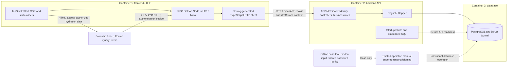
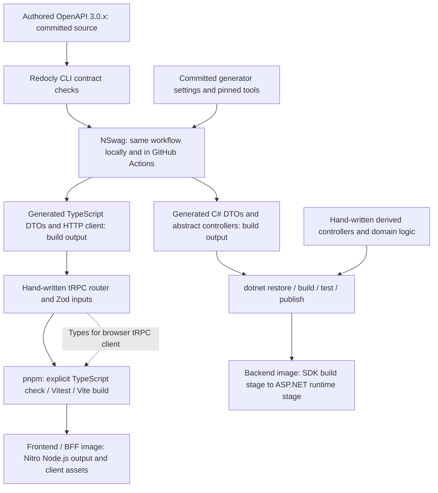
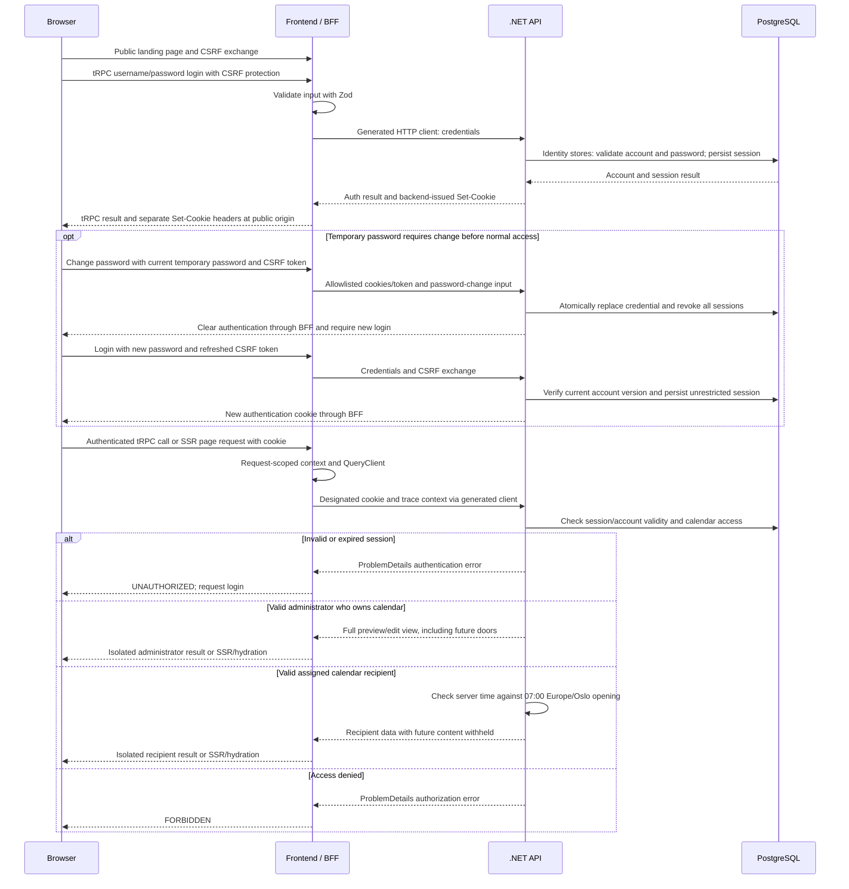
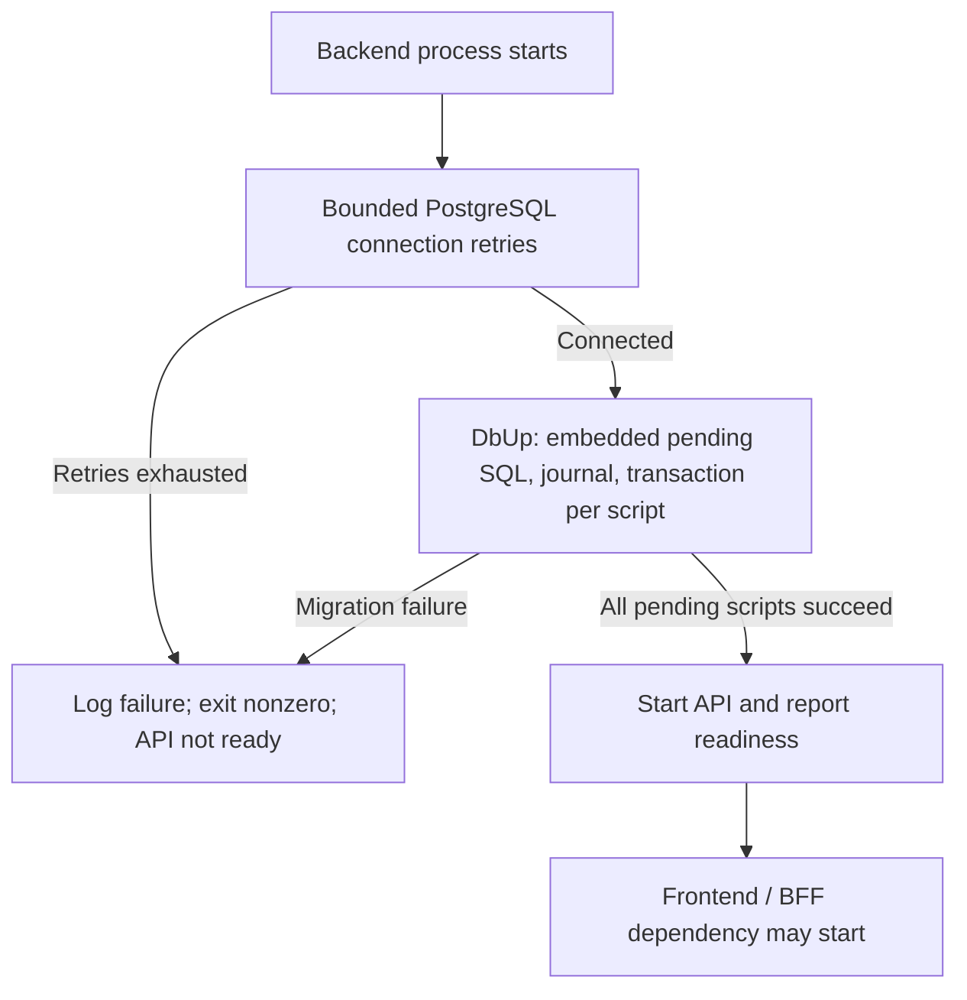

# Technology stack and architecture

Last reviewed: 2026-10-18

This document describes the agreed design for the advent calendar. The repository
now includes an ASP.NET Core backend, authored OpenAPI contract and C# generation,
PostgreSQL migrations, API integration tests and local/CI build commands. The
Compose stack runs frontend/BFF, backend and database; identity, calendar
access rules and deployment remain future work. The calendar page displays a
stored title and 24 static doors through tRPC and the generated backend client,
with Norwegian/English interface translations. The implemented POST/GET API
requires no user context. See [backend workflows](../src/backend/README.md).

Application source belongs under root `src/`: the backend is in `src/backend`,
the authored OpenAPI contract and generator settings in the sibling `src/contract`,
and frontend/BFF source uses `src/frontend`. Developer tooling remains
under `tools/`.

## System responsibilities

The system has three long-running containers, initially one instance of each.
The browser executes JavaScript served by the frontend container. The BFF
(backend for frontend) runs in that same container; it adapts backend responses
for the UI while the backend remains responsible for identity, authorization,
calendar rules, and persistence.

| Boundary | Selected technology | Responsibility |
| --- | --- | --- |
| Browser UI | TypeScript, React, TanStack Router and Query | Navigation, interactive calendars, forms, and browser query cache |
| Frontend/BFF container | TanStack Start, tRPC, Node.js LTS, Nitro | SSR, assets, browser API, request-scoped session relay, backend calls |
| Backend API container | C#, ASP.NET Core, .NET LTS, System.Text.Json | Credentials, sessions, authorization, calendar business rules, API validation |
| Database container | PostgreSQL | Persistent accounts, session validity, calendar ownership/recipient assignments, and migration journal |
| Backend data access | Npgsql, Dapper, hand-written parameterized SQL | Connections, SQL execution, and C# result mapping |
| Backend migrations | DbUp with its PostgreSQL provider and SQL scripts | Schema upgrades during backend startup |

Browser code calls the BFF through tRPC using `@trpc/tanstack-react-query`.
Only BFF server code uses the generated backend HTTP client and backend
connection configuration. The browser does not connect directly to PostgreSQL
or use the backend client. The offline hash tool cannot connect to the database
or create accounts; a trusted operator manually provisions superadmins. Neither
is another long-running service. DbUp runs inside the backend process and never
seeds user accounts.
The [tRPC integration documentation](https://trpc.io/docs/client/tanstack-react-query/setup)
describes router-derived client types and TanStack Query option factories.

## Frontend, rendering, and forms

TanStack Start provides the React frontend and TypeScript BFF, with TanStack
Router for navigation and TanStack Query for server data. SSR is the default:
each server request receives its own QueryClient, tRPC context, and authenticated
backend-call context. Initial loaders obtain data through the BFF and prefetch
the queries needed for initial HTML. TanStack Start's Query integration transfers
that authorized data into the browser cache during hydration. Never share a
server QueryClient or mutable credential headers across requests. This isolation
matches the [Query SSR guidance](https://tanstack.com/query/latest/docs/framework/react/guides/ssr).

Browser caches must distinguish the current user, calendar, and administrator
versus recipient view. Clear or replace protected cached data when the authenticated
session changes. SSR output, hydrated data, and prefetches must satisfy the same
authorization rules as an API response. Shared response caches must not reuse
authenticated output across users or access modes. Refresh data when a door opens
and after edits or moves; a cached locked result must not hide newly available
content indefinitely. A client timer may trigger refresh, but only the backend
decides whether content has opened.

Use Tailwind CSS through its [Vite integration](https://tailwindcss.com/docs/installation/using-vite)
and shadcn/ui components for calendar and administrator screens. shadcn/ui
component source is maintained, customized, and committed by this project;
it has a different lifecycle from build-generated API contracts excluded from Git.
The [shadcn/ui Start integration](https://ui.shadcn.com/docs/installation/tanstack)
documents the framework setup. Verify styling and components against the selected
React, Start, and Vite versions, including SSR and hydration behavior.

Login, password-change, and authorized administration forms use TanStack Form with Zod for
state and client-side validation, with shadcn/ui fields. Reuse compatible Zod
schemas between forms and BFF inputs when those inputs match. Attach structured
BFF/API errors to the appropriate fields; show submission-wide failures
separately. Client validation provides feedback, while BFF and backend validation
remain independent enforcement boundaries. The
[TanStack Form component integration](https://ui.shadcn.com/docs/forms/tanstack-form)
supports this UI choice. It does not select automatic OpenAPI-to-Zod generation.

## Interface languages

The application interface will initially support Norwegian and English, with
Norwegian as the default and a language selector for switching. Use Paraglide JS
for interface translations; TanStack documents its
[Start/SSR integration](https://tanstack.com/router/latest/docs/guide/internationalization-i18n).
The selected language must agree between server-rendered HTML and browser
hydration, with language state isolated between server requests.

Translation covers application-owned interface text, labels, prompts, and
user-facing error/validation messages. User-authored content, including calendar
titles and door text, stays in the language in which it was written. Switching
interface languages does not change stored content or require per-language
versions of it.

## Contracts and generated code

There are two distinct communication contracts:

| Connection | Source of truth | Consumer |
| --- | --- | --- |
| Browser to BFF | TypeScript tRPC router, with Zod runtime input schemas | Router-derived tRPC client types and TanStack Query integration |
| BFF to backend | Authored OpenAPI 3.0.x document | NSwag-generated TypeScript DTOs/client and C# DTOs/abstract controllers |

The backend contract is spec-first. Author the OpenAPI document before generating
code; do not derive the source contract from backend implementation annotations.
NSwag reads the authored file without a running or compiled backend. Commit the
spec, generator configuration, and pinned tools. Generate code before consumer
compilation in local builds, development builds, and GitHub Actions. Keep
generated output outside Git; a clean checkout must be sufficient to rebuild it.

Configure C# controller generation for ASP.NET Core and the abstract style.
Hand-written derived classes implement the endpoints and business logic; keep
them separate from generated DTOs and contracts. After contract changes,
regenerate both language outputs and adapt the derived controllers and BFF
procedures. Never hand-maintain generated code. The
[NSwag controller generator](https://github.com/RicoSuter/NSwag/wiki/CSharpControllerGenerator)
provides controller-contract generation. Compilation checks signatures; runtime
tests must still verify routes, HTTP methods, parameter binding, actual bodies,
status codes, and validation.

Configure NSwag C# DTO generation explicitly for System.Text.Json, as exposed
by the [C# generator settings](https://github.com/RicoSuter/NJsonSchema/blob/master/src/NJsonSchema.CodeGeneration.CSharp/CSharpGeneratorSettings.cs).
Verify generated attributes, converters, required-property handling, nullability,
enums, date types, and any polymorphism the actual contract uses. Do not silently
switch serializer or edit generated DTOs if compatibility problems appear.

### Wire and persistence representations

Use camelCase property names in OpenAPI, JSON, and TypeScript DTOs. Generated C#
properties use PascalCase, with serializer settings and generated attributes
preserving the authored wire names. The following conventions apply when a field
is introduced; examples are illustrative rather than new API resources.

| Value | OpenAPI and JSON | C# | TypeScript | PostgreSQL |
| --- | --- | --- | --- | --- |
| Unique identifier | `string`, `format: uuid`; UUID text | `Guid` | `string` | `uuid` |
| Date without a time | `string`, `format: date`; `2026-12-01` | `DateOnly` | `string` | `date` |
| Instant | `string`, `format: date-time`; RFC 3339 UTC, e.g. `2026-12-01T06:00:00Z` | UTC `DateTimeOffset` | `string` | `timestamp with time zone` |
| Ordinary integer | Integer number with explicit safe bounds | Numeric type fitting field range | `number` | Type fitting field range |
| Potentially large integer | Integer-formatted string for every value of the field | Domain numeric type chosen for its range; explicit mapping from DTO text | `string` | Chosen for actual field range |
| Exact decimal, if needed | Decimal-formatted string with field-level limits | Domain `decimal`; explicit mapping from DTO text | `string` | `numeric` with explicit precision and scale |

Require fields and disallow null by default as a project authoring convention.
List required properties in OpenAPI's `required` array. Omit optional properties
from that array; permit null only with `nullable: true`. Presence and nullability
are independent: a required nullable property must be present and may contain
null. This convention does not change OpenAPI's defaults. Generated C# nullability
alone does not enforce presence. Check missing and explicit null inputs separately.

Enums are `type: string` with explicitly enumerated camelCase wire values, such
as `draft` and `pendingApproval`. Generation, serialization, and backend
validation must preserve the exact values and reject numeric or unlisted values.
UUID version and generation location remain decisions for runnable setup.

Keep date and instant fields as strings in generated TypeScript code and the
BFF; parse only for display when needed. Normalize backend instants to UTC and
write UTC values with Npgsql. PostgreSQL `timestamp with time zone` represents
an instant, not a stored calendar timezone. Verify DateOnly/DateTimeOffset
generation, JSON round trips, and Npgsql/Dapper mappings, adding hand-written
type mappings if needed. See [Npgsql date/time handling](https://www.npgsql.org/doc/types/datetime.html).
Interpret business dates using Europe/Oslo separately from transport formats.

Every JSON integer number has explicit minimum/maximum values within
`-9007199254740991` to `9007199254740991`. If a field can exceed that safe range,
all of its values use strings, even small values. Declare string syntax and range
in OpenAPI instead of declaring numeric `int64` while emitting quoted numbers.
Preserve digits without conversion through JavaScript number.

Exact decimals are a conditional convention; no decimal fields or frontend
arithmetic library are currently required. If introduced, specify syntax, range,
precision, and scale within C# decimal limits. Map string DTOs to domain decimal
values with culture-independent parsing/formatting, use PostgreSQL numeric,
and verify exact database and JSON round trips.

### Validation, errors, and call policy

Validate every tRPC input at runtime with Zod, including applicable UUID formats,
required/null distinctions, enums, and numeric bounds. Independently validate
backend requests against the authored OpenAPI constraints and enforce business
rules. Types, generated contracts, and a successful BFF check do not replace API
validation. Verify representative invalid input at both boundaries.

Define backend error responses in OpenAPI as ProblemDetails, including status
codes and structured field errors. The BFF translates errors from the generated
HTTP client and transport failures without a ProblemDetails body consistently:

| Condition | Client-facing tRPC code | UI behavior |
| --- | --- | --- |
| Invalid input / field validation / BFF Zod failure | `BAD_REQUEST` | Attach structured field errors; show general input errors separately |
| Missing, invalidated, or expired session | `UNAUTHORIZED` | Request login |
| Authenticated but denied access | `FORBIDDEN` | Show denied access |
| Missing resource | `NOT_FOUND` | Show unavailable resource |
| State conflict | `CONFLICT` | Explain conflict and allow refresh/correction |
| Backend unavailable, including transient network failure | `SERVICE_UNAVAILABLE` | Show availability failure |
| Total backend call deadline exceeded | `TIMEOUT` | Show timeout |
| Unexpected backend/transport failure | `INTERNAL_SERVER_ERROR` | Show general failure |

Preserve structured field errors in tRPC error data for the form, including Zod
failures at the BFF boundary. Verify each mapping rather than relying on HTTP
client exceptions automatically becoming tRPC errors. These codes are supported
by [tRPC error handling](https://trpc.io/docs/server/error-handling).

Ordinary BFF-to-API calls have a configurable 10-second total deadline covering
all attempts and waiting. Cancel outstanding HTTP work when that deadline
expires or the caller cancels. Allow at most one retry for GET/HEAD after a network
failure or HTTP 502, 503, or 504, with a 250-500 ms delay only if time remains.
Never reset the deadline. Do not retry other errors, explicit cancellation, or
expired calls. Do not automatically retry writes; any future exception requires
an agreed idempotency mechanism. Disable additional TanStack Query retries for
these browser and SSR queries, preventing multiplied attempts. Operation-specific
timeouts may be configured when concrete requirements justify them.

## Authentication and calendar access

The agreed account model uses usernames and passwords, with exactly three roles:
`superadmin`, `calendarAdmin` and `calendarUser`. Public registration is excluded.
Superadmins can create calendaradmins and ordinary users through authorized API
operations; calendaradmins can create only ordinary users. Superadmins themselves
are provisioned only by intentional manual database operations. No environment,
startup, migration, script or deployment path automatically creates user accounts.

Each ordinary user has a fixed responsible calendaradmin, independently of the
audit creator. That administrator can list and reset only assigned accounts that
currently hold the ordinary role. Superadmin can maintain nonsuperadmin accounts;
other-account superadmin maintenance remains manual. Role transitions preserve
responsibility and cannot bypass reset boundaries or demotion dependencies.

The public landing page remains public. Future calendar access requires login:
each calendar has one recipient account, and a recipient may access multiple
assigned calendars. Calendaradmins manage their own calendars, not other
administrators' calendars merely by role. Assignment and any invitation behavior
are separate calendar work; the former email-registration/invitation-membership
flow is superseded. User-management superadmin permissions do not define future
calendar authority.

These are agreed requirements, not implemented authentication. The current
calendar POST/GET API remains anonymous. Backend user management is the next
increment; calendar authorization/assignment, frontend/BFF security integration
and production database hardening must be completed and verified before production.
The end-to-end sequence below describes the future integrated system.

### Credentials and manual provisioning

Use ASP.NET Core Identity with custom Npgsql/Dapper stores and a maintained
Argon2id password hasher; retain UUID/Guid identifiers, DbUp and the exclusion of
Entity Framework. Usernames are globally unique and case-insensitive, with shared
Unicode-aware normalization and a database uniqueness constraint. Duplicate
creation rejects the request instead of changing credentials or granting access.
The offline hash tool shares password policy/hashing with the backend, accepts
hidden input and produces a hash without database access or account writes.
Only the operator performs the actual superadmin database insertion.

Administrator passwords require 15-128 Unicode code points and ordinary passwords
8-128, with uppercase, lowercase and punctuation/symbol characters and local
known-weak-password rejection. This approved policy is not a claim of NIST
compliance. No OAuth2, external identity provider or MFA is added. Detailed
requirements for hashing costs, input validation, secrets and safe logging belong
to the [authentication rules](../.agents/rules/authentication-and-calendar-access.md#passwords-and-sensitive-operations).

API-created accounts start with temporary credentials. Initial, reset and promotion
passwords expire after 30 minutes and allow only a restricted password-change
flow; normal access requires a different compliant password and a new login.
Administrators privately deliver temporary credentials to identity-verified
recipients. Promotion replaces the lower-trust credential atomically, preventing
a former responsible administrator from retaining a known password at higher privilege.

Sensitive administrative writes require password verification within five minutes,
bound to the current unrestricted session and account security version. Persisted
account lockout allows five failures within a rolling 15-minute window, followed
by a fixed 15-minute pause. Independent IP/global budgets and hashing bounds apply.
Security versions and transactional actor/target checks prevent stale login,
password changes, resets and hash upgrades from restoring obsolete authority.
See the rules for exact lifecycle, concurrency and authorization requirements.

### Cookie relay and request authentication

The backend issues and validates ASP.NET Core authentication cookies. The browser
holds a host-only cookie for the public frontend/BFF origin: HttpOnly,
SameSite=Lax, and Secure in production. On each call, including SSR, the BFF relays
only the designated authentication/antiforgery cookies and request-token header
to the API as needed, using an explicit allowlist. Forward relevant backend
Set-Cookie headers for login, logout, CSRF issuance and reissuance as separate response
headers, ensuring their scope matches the public origin. The BFF does not decrypt
cookies or accept browser-supplied user IDs or role headers as identity.

Use ASP.NET Core's built-in token-based antiforgery validation for state-changing
authentication/user operations, including login. SameSite alone is insufficient.
Refresh tokens after principal changes without extending authentication expiry.
Backend verification belongs to the user-management increment; the later BFF
integration must verify cookie/header relay end to end through the public origin.
See Microsoft's
[CSRF guidance](https://learn.microsoft.com/en-us/aspnet/core/security/anti-request-forgery?view=aspnetcore-10.0).
Describe authentication operations and cookie security in the authored OpenAPI.
Keep React login screens in the frontend and make API authentication failures
return structured errors instead of HTML login redirects.

The backend owns Data Protection keys; the Node.js BFF does not need them.
Keys must be durable and protected across backend container replacement.
The concrete key storage configuration belongs to deployment work alongside
hosting and secrets. Cookie validation must also consult persisted session and
account validity through PostgreSQL stores; cookie integrity alone is insufficient.
Validity checks fail closed if persistence is unavailable. All authentication and
user-management responses, including errors, CSRF tokens and cookie responses,
require `Cache-Control: no-store` and exclusion from shared response/output caches.
The backend implements that protection first; the future BFF must preserve it.

### Session lifetimes and invalidation

Ordinary users have persistent sessions lasting at most 30 days from successful
login; administrators have persistent sessions lasting at most eight hours.
Apply the shorter limit based on the authenticated account's privileges.
Disable sliding expiration and keep cookie expiration and backend ticket expiry
consistent. Activity, Identity validation, and cookie reissuance cannot extend
the original deadline. Browser restarts preserve login within the limit;
expiration requires a new login. The ordinary-user duration reduces password
entry for children who may need help signing in.

Temporary-password sessions instead expire at the earlier of ten minutes after
login and the persisted 30-minute credential deadline. They allow only session
inspection, required CSRF refresh, own-password change and logout. Repeated login
or activity cannot extend the credential deadline. An expired temporary credential
requires an authorized reset; expiry never restores normal access.

Logout invalidates the current session server-side and clears its browser cookie;
other sessions for the same account remain valid. Password changes, disabling an
account, resets or role changes invalidate all of its sessions. Password change
requires a new login, and enabling an account never revives revoked sessions.
The API must reject invalidated cookies on subsequent requests, including replay
through the BFF and SSR. Periodic Identity validation alone must not delay this
requirement. Persist session/account validity using the selected PostgreSQL
stack; account versions, temporary state and recent verification are part of
backend user-management persistence. Preserve original expiry
through all validation/reissuance. The
[cookie authentication guidance](https://learn.microsoft.com/en-us/aspnet/core/security/authentication/cookie?view=aspnetcore-10.0)
describes validation hooks; project-specific invalidation still needs implementation.

### Calendar time and editing

All calendars initially use Europe/Oslo. Derive each opening instant from the
door's assigned date and 07:00 in that named timezone. Use its timezone rules
instead of a fixed UTC offset, browser clock, or container local timezone. Store
and transport instants in UTC and keep calendar dates as DateOnly/date strings.
There is no per-calendar timezone selection in the initial version.

The backend compares current server time with the opening instant and checks
session validity and recipient assignment. At 07:00 the assigned door opens; earlier doors
remain available to assigned recipients. Future content must be absent from recipient
API responses, SSR HTML, hydration data, and prefetched/browser caches. Direct
API calls and changed browser clocks cannot bypass opening rules. Opening at
07:00 avoids encouraging children to wait until midnight.

Calendaradmins have full preview and editing access to calendars they own before
and during the calendar period, including future doors. They can prepare the
whole calendar and keep editing after the period starts. Moving content requires
both source and destination doors to be before their scheduled opening instant
when the backend authorizes the move. Availability is defined by time, not whether
a particular recipient clicked a door. Check administrator privileges and ownership
on every preview/edit/move operation; preserve separate administrator/recipient
responses and caches, and refresh affected data after changes.

## Data access, migrations, and startup

Use Npgsql for PostgreSQL connections and Dapper for parameterized SQL and result
mapping. Hand-written SQL implements application and Identity storage; DbUp
alone owns schema migrations. Entity Framework is excluded. Unique identifiers
use PostgreSQL uuid columns and C# Guid values as described above.

Package ordered, numbered SQL files as embedded resources in the backend
assembly, together with the `dbup-postgresql` provider. Examples of the naming
pattern are `0001_create_calendars.sql` and `0002_add_calendar_title.sql`;
these are examples, not existing migrations. Keep sequence numbers unique,
ordering deterministic, and embedded resource identities stable.

At runtime, backend startup waits for database availability using bounded
connection retries, applies pending DbUp scripts, and only then accepts API
requests and reports readiness. Migration execution never occurs during image
building. Failure aborts processing and prevents API startup, with a nonzero
container exit status. Compose readiness dependencies complement the backend's
own bounded retries.

Explicitly configure `WithTransactionPerScript()`. Each successful script commits
with its journal entry; a failed script rolls back its transactional changes
while earlier scripts remain committed. On restart, the journal determines the
remaining scripts. An operation requiring execution outside a transaction needs
an explicit documented exception and a recovery procedure for partial changes;
do not disable transactions globally. See [DbUp transactions](https://dbup.readthedocs.io/en/latest/more-info/transactions/).

Use DbUp's standard PostgreSQL journal initially. Its
[implementation](https://github.com/DbUp/dbup-postgresql/blob/master/src/dbup-postgresql/PostgresqlTableJournal.cs)
tracks script names and application timestamps, not runtime content checksums.
Published scripts must retain their content and identities: correct mistakes with a new numbered
migration. CI must compare with a reliable set of prior released migrations and
reject edits, deletions, and renames. Establish that release baseline and verify
the integrity check when creating build/release automation. Verify embedded
resource ordering/packaging and journal-based restart behavior as part of setup.

## Builds and local development

All commands in this section describe future setup; package scripts, project
paths, Dockerfiles, and Compose configuration do not yet exist.

Frontend/BFF builds use pnpm and Vite. Generate backend client code before
explicit TypeScript type checking and the Vite production build. Vite transpiles
TypeScript without performing type checks, as its
[TypeScript documentation](https://vite.dev/guide/features.html#typescript)
explains. TanStack Start's Vite integration uses Nitro to produce Node.js server
output and browser assets. The expected package-script shape is `pnpm build`
invoking `vite build` and `pnpm start` invoking `node .output/server/index.mjs`.
Validate that output/start shape with the pinned Nitro/Start/Vite/Node versions
when building runnable setup. The [Start hosting guide](https://tanstack.com/start/latest/docs/framework/react/guide/hosting)
describes this Node.js/Nitro workflow.

Backend builds use dotnet CLI/MSBuild: `dotnet restore`, `dotnet build`,
`dotnet test`, and `dotnet publish`. Hook generation into the shared build workflow
before compilation, including clean builds. The Dockerfile has an SDK build
stage for restore, generation, build, and publish, then an ASP.NET runtime stage
containing the published application, DbUp provider, and embedded migrations.
This provides explicit control of runtime and application contents. SDK container
publishing was considered as an alternative; NUKE remains optional future build
orchestration. Neither replaces the selected CLI/MSBuild and multistage Dockerfile
approach. See Microsoft's [Docker build guide](https://learn.microsoft.com/en-us/aspnet/core/host-and-deploy/docker/building-net-docker-images)
and [SDK container publishing alternative](https://learn.microsoft.com/en-us/dotnet/core/containers/sdk-publish).

| Local mode | Processes | Connection addresses | Readiness and generation |
| --- | --- | --- | --- |
| Full Docker Compose | Frontend/BFF, API, PostgreSQL in three containers | BFF uses API service DNS; API uses PostgreSQL service DNS and container port | Database health, then API migration/readiness, then frontend/BFF; generate during builds |
| Daily host development | PostgreSQL in Compose; `pnpm dev` and `dotnet watch` on host | BFF uses configured local API address; API uses localhost and the published database port | Start database, then API/migrations and frontend; development builds generate contract code |

Persist the development PostgreSQL database in a named volume. Use health checks
and readiness-based dependencies: PostgreSQL must be ready for migrations and
API readiness must follow successful migration execution. Compose can wait on
`service_healthy`, as described in [startup ordering](https://docs.docker.com/compose/how-tos/startup-order/).
Configure addresses per mode instead of using localhost between containers.
Start only the database Compose service in host mode so applications do not run
twice unintentionally. Testcontainers databases are isolated and separate from
this persistent development volume. Setup must verify both workflows, persistence,
startup failure, and restart behavior.

## Verification and CI/CD

GitHub Actions is the selected CI/CD platform. Local and CI builds invoke the
same generation and validation workflows. From a clean checkout, check the
authored contract with Redocly CLI, generate both languages, compile .NET,
explicitly type-check TypeScript, run applicable tests, and build Vite output
and container artifacts. Do not compare generated output with committed files:
generated files are not versioned. Production deployment integration and optional
post-deployment testing stages depend on the later hosting decision.

| Check | Tool and environment | Required evidence when implementing |
| --- | --- | --- |
| OpenAPI and generated code | Redocly CLI, NSwag, .NET compilation, TypeScript type check | Clean build from authored spec, representative schema generation, no running backend required |
| Frontend/BFF units | Vitest through pnpm, locally and GitHub Actions | Zod invalid inputs, field-error translation, frontend behavior, transport errors, deadlines/cancellation and attempt counts; isolate external dependencies and select runtime per test |
| Backend API integration | xUnit and isolated PostgreSQL Testcontainers, locally and GitHub Actions | Real request/response behavior, data access, OpenAPI agreement, actual DbUp scripts, transactions and journal restart |
| Optional end-to-end | Playwright against environment after deployment | Browser/BFF/API flows; deployment-stage details deferred |

Backend integration tests require a compatible container runtime in local and CI
environments. Apply the application's actual migrations to isolated test databases
and exercise Npgsql/Dapper access. Temporary
[PostgreSQL Testcontainers](https://dotnet.testcontainers.org/modules/postgres/)
do not change the three-container deployment model. Contract checks may be part
of API integration tests; no standalone contract-only suite is required.

The completed system must demonstrate the following meaningful boundary checks.
Backend user-management checks belong to that increment; browser/BFF and calendar
security checks remain separate follow-up work and must pass before production:

- Compile generated abstract controllers and exercise concrete routes, methods,
  parameter bindings, responses, status codes, and OpenAPI-aligned validation.
- Round-trip wire names, required/missing/null values, enum strings, UUIDs,
  DateOnly/UTC DateTimeOffset, exact integer digits, conditional decimals, and
  any used polymorphism through generation, serialization, and applicable stores.
- Exercise BFF Zod failures, API ProblemDetails/field errors, transport failures,
  total deadline, cancellation, one permitted read retry, and no write or Query retries.
- Verify direct account APIs enforce the three-role matrix, fixed responsibility
  and scoped reset/list access, with no public registration, account seeding or API
  superadmin creation. Verify the offline hash tool cannot connect or write accounts.
- Verify temporary initial/reset/promotion credentials, restricted sessions, recent
  administrator verification, lockout/resource budgets, no-store responses and
  concurrent security-version checks against real PostgreSQL in backend tests.
- Verify cookie relay, separate Set-Cookie headers, login/logout, CSRF rejection,
  authenticated SSR, and concurrent-user context/cache isolation.
- Use controlled time for browser-restart persistence, 30-day/eight-hour expiry,
  no sliding renewal, per-session logout, account-wide invalidation, rejected
  cookie replay, and preservation of unrelated sessions after ordinary logout.
- Check unauthorized calendar access and cross-owner preview/edit attempts;
  test immediately before, at, and after 07:00 using controlled backend time,
  changed browser clocks, and differing client/server timezone settings.
- Confirm future recipient content is absent from API, SSR, hydration, prefetch, and
  caches; separate administrator data; verify refresh at opening and after edits,
  and reject moves across either source/destination opening boundary.
- Verify database startup readiness, migrations, transactional rollback, earlier
  committed scripts, deterministic resource names, release integrity checks,
  journal restart, and development volume persistence.
- Check UI/form package compatibility and SSR/hydration, plus correlation of
  structured BFF/API logs across concurrent requests.

## Version policy

Use the latest LTS for products with an LTS policy; otherwise choose the latest
stable supported versions compatible with the selected stack. LTS releases are
not available for every dependency. Pin selected tools/dependencies and keep dependency
lockfiles; avoid floating `latest` builds. Check direct and transitive security
updates when selecting versions and building runnable setup.

As verified on 2026-10-10, .NET 10 is the latest released .NET LTS and Node.js 24
is the latest Node.js LTS. These are dated baseline examples, not exact SDK or
package pins. Recheck at setup time. See the [.NET support policy](https://dotnet.microsoft.com/en-us/platform/support/policy/dotnet-core)
and [Node.js release schedule](https://github.com/nodejs/Release).
PostgreSQL uses a supported-major-version policy rather than a separate LTS
designation; select a supported release with current patches according to its
[version policy](https://www.postgresql.org/support/versioning/).

TanStack Start's Release Candidate status is an explicitly accepted exception
to the stable-release policy, confirmed against its
[overview](https://tanstack.com/start/latest/docs/framework/react/overview).
Use a compatible, security-patched pinned release and inspect resolved transitive
dependencies. The [Start security update](https://tanstack.com/blog/tanstack-start-security-update-cve-2026-102989)
illustrates why checking only the top-level package version is insufficient.
Exact dependency versions and mutual package compatibility require representative
generation/build/SSR checks during runnable setup; this documentation makes no
claim that an unbuilt package combination has already passed them.

## Deployment constraints and diagnostics

Initially deploy one instance of each container; downtime during deployment is
acceptable. Stop the old API before migrations that could invalidate its schema
assumptions. Start the replacement backend, wait for database availability and
successful migrations, and bring it into service only when ready. Bring the
frontend/BFF into service with the ready API. Every backend restart checks pending
migrations through the journal. Reverting an application image does not undo
database migrations; recovery needs a separate plan.

BFF and API emit structured JSON console logs with timestamp, severity, service,
and request context. Use [.NET built-in JSON console formatting](https://learn.microsoft.com/en-us/dotnet/core/extensions/logging/console-log-formatter)
and equivalent
structured BFF output. Propagate W3C Trace Context in BFF-to-API HTTP calls,
creating valid request-scoped context when absent, and include the shared
`traceId` in relevant logs, including SSR. Verify correlation under concurrency.
The [W3C specification](https://www.w3.org/TR/trace-context/) defines the transport.
This selects correlated logs; full distributed tracing infrastructure is deferred.

## Deferred decisions

| Follow-up task | Decisions still required |
| --- | --- |
| Runnable application/setup | Remaining API resources and content models/screens, UUID version/generation location, exact package/tool pins, representative serialization/mapping checks and build/setup maintenance |
| Backend user management | Identity stores, Argon2id provider/costs and local weak-password source, account/session schema, offline hash-tool packaging and implementation/verification of the agreed security controls |
| Calendar authorization and frontend/BFF integration | Owner/recipient assignment and any invitation behavior, calendar endpoint enforcement, account screens, allowlisted cookie/CSRF relay and browser/SSR/cache verification; no public registration |
| Build/release automation | Concrete GitHub Actions workflows, reliable prior-release migration baseline and integrity enforcement, artifact packaging |
| Deployment | Production hosting, HTTPS/TLS termination, secrets, persistent database storage, backups, recovery and restoration checks, durable protected Data Protection key configuration, controlled manual superadmin operator access, database hardening, deployment integration and optional Playwright stage |
| Observability/operations | Full distributed tracing, collection/storage and visualization of service timings |

No production hosting platform has been selected. Sliplane is only a candidate,
with no assumed capabilities. The deployment task must preserve the selected
three-container, single-instance architecture and accepted downtime. These
deferrals do not weaken backend access rules, startup migration safety, or the
durable Data Protection key requirement.
